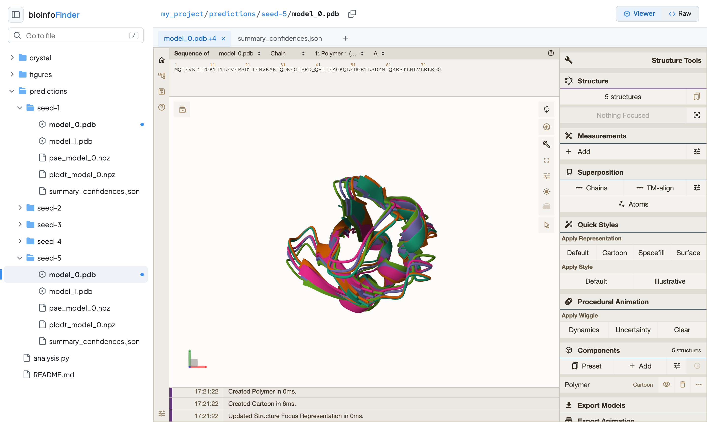

# bioinfoFinder

**`jupyter lab`, but for the [Mol\*](https://molstar.org) viewer.**

Stop dragging structure files into a browser tab one at a time. Run `bioinfofinder` in any folder and Mol\* opens in your browser, with a file browser for everything under that folder.



```bash
cd ~/my_project/output
bioinfofinder
```

## Features

- **A file tree in the sidebar.** Folders open in place, the full path sits on top like a `pwd` line, and new files show up on their own while a job is still running.
- **Tabs.** Each tab is its own scene. Right-click a file → *Open in new tab* (or ⌘-click / middle-click) to compare structures side by side.
- **Open several at once.** Hover a file and tick its box, then *Add to scene* to overlay models, e.g. one model from every seed.
- **MD trajectories.** Tick a topology/structure + trajectory (e.g. `.psf` + `.dcd`, `.gro` + `.xtc`) and *Add to scene* loads the run.
- **Viewer | Raw.** Flip any structure tab to its raw text, with line numbers.
- **Prediction outputs, not just structures.** JSON confidence files and `.npz` arrays (pLDDT, PAE, …) open as text; PNG/JPG/SVG images and PDFs open as a preview.
- **Search every subfolder.** *Go to file* (press `/`) finds any file under the folder.
- **Lots of formats.** PDB/mmCIF/BCIF, PDBQT, GRO, MOL/MOL2/SDF, XYZ, PSF/PRMTOP/TOP, XTC/TRR/DCD/NC/LAMMPS, CCP4/MRC/MAP/DSN6/CUBE/DX, and `.molj`/`.molx`/`.mvsj` sessions. `.gz` files are decompressed on the fly.
- **Drag and drop.** You can also drag files from Finder straight into the viewer.
- **Zero dependencies.** Only the Python standard library. Runs on macOS and Linux.

## Install

Needs Python 3.8+ and [pipx](https://pipx.pypa.io):

```bash
pipx install git+https://github.com/swamyshogan/bioinfofinder.git
```

No pipx yet? On macOS run `brew install pipx && pipx ensurepath`; on Linux run `python3 -m pip install --user pipx && python3 -m pipx ensurepath`. Then open a new terminal.

## Usage

```bash
bioinfofinder                  # serve the current folder
bioinfofinder ~/runs/seed_3    # serve another folder
bioinfofinder model.pdb        # open one file right away
```

| option | what it does |
|---|---|
| `[folder \| file.pdb]` | folder to serve (default `.`), or one file to open right away |
| `-p`, `--port 8890` | port to try first (moves up if that one is busy) |
| `--no-browser` | don't open a tab |
| `--hidden` | show dotfiles |
| `--host 0.0.0.0` | share on the network (anyone who can reach the port can read the folder) |

The server only listens on 127.0.0.1 by default and won't serve paths outside the folder you gave it.

The Mol\* build (v5.13.1) is downloaded once into `~/.cache/bioinfofinder/` and works offline after that. Set `BIOINFOFINDER_MOLSTAR_VERSION` to use a different version.

## Update / uninstall

```bash
pipx upgrade bioinfofinder
pipx uninstall bioinfofinder
```

## Development

```bash
git clone https://github.com/swamyshogan/bioinfofinder.git
cd bioinfofinder
pipx install -e .    # edits to the code take effect immediately
```

## Citing Mol\*

bioinfoFinder is only a launcher; the viewer is [Mol\*](https://github.com/molstar/molstar). If you use it in your work, please cite Mol\*:

> David Sehnal, Sebastian Bittrich, Mandar Deshpande, Radka Svobodová, Karel Berka, Václav Bazgier, Sameer Velankar, Stephen K Burley, Jaroslav Koča, Alexander S Rose. [Mol* Viewer: modern web app for 3D visualization and analysis of large biomolecular structures](https://doi.org/10.1093/nar/gkab314). *Nucleic Acids Research*, 2021. https://doi.org/10.1093/nar/gkab314

## License

[MIT](LICENSE). Use it, fork it, share it.

It loads the [Mol\*](https://github.com/molstar/molstar) Viewer, which is also MIT-licensed (Copyright (c) Mol\* contributors). bioinfoFinder is an independent project, not affiliated with or endorsed by the Mol\* team.

<sub>Ideation by **Shogan** · Executed by **Claude**</sub>
